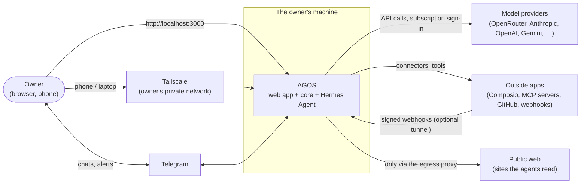
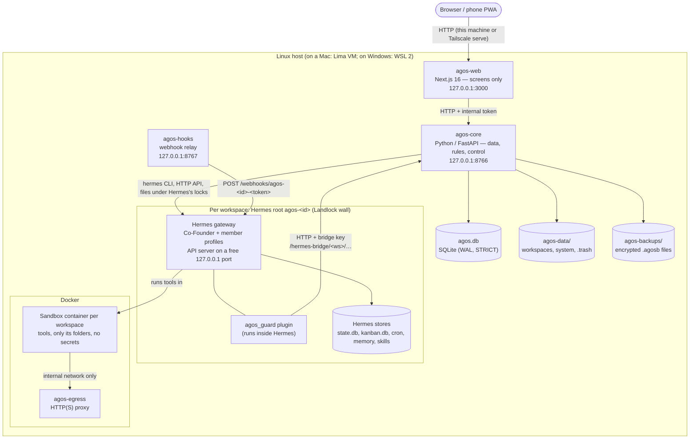
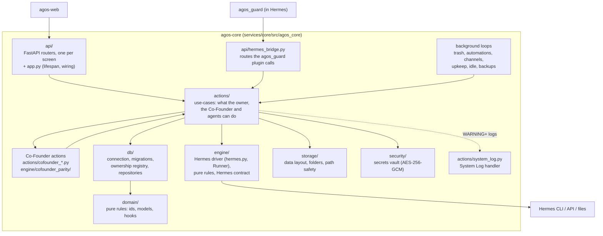
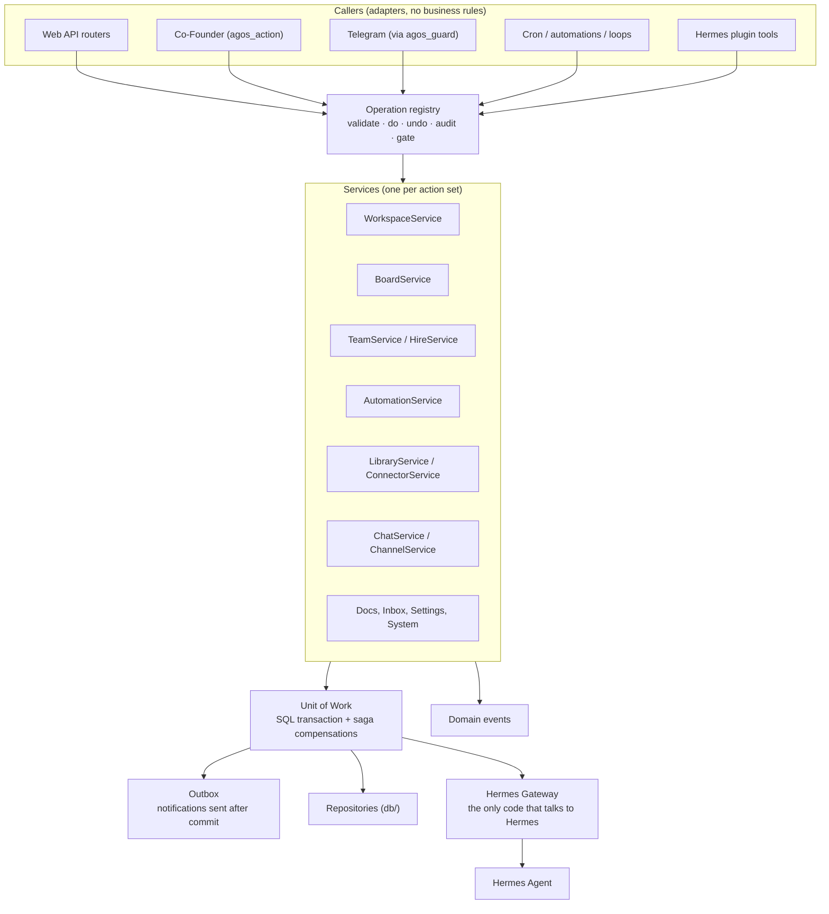

# AGOS — Architecture

This is the reference for how AGOS is built. If the code and this document
disagree, one of them is wrong: fix it, don't ignore it.

- Sections 1–9 describe AGOS **as it is today**.
- Section 10 describes the **target design** (the service layer). It is being
  migrated step by step. New code follows it.
- The reasons behind each choice are in the [decision records](docs/adr/README.md).
- Words used here are defined in the [glossary](docs/glossary.md).

---

## 1. What AGOS is

AGOS is a self-hosted app for running an AI team on your own machine. Each
installation serves **one owner**. The owner's work is split into
**workspaces**, one per project. Each workspace has a **Co-Founder** agent and
a team of **members** (agents).

**Hermes Agent is the engine of everything.** Every agent, chat session,
memory, skill, scheduled job, Kanban board, room and sandbox lives in
[Hermes Agent](https://github.com/NousResearch/hermes-agent). AGOS **shows**
and **controls**. It reads Hermes when it needs something and writes through
Hermes (its CLI, its API, or its own code run in its runtime). AGOS keeps **no
copy** of anything Hermes has a place for
([docs/hermes-ownership.md](docs/hermes-ownership.md)).

Fixed principles:

| Principle                | What it means                                                                                                   |
| ------------------------ | --------------------------------------------------------------------------------------------------------------- |
| One owner, no login      | AGOS has no accounts. It listens on 127.0.0.1 only. Other devices reach it only through the owner's Tailscale.  |
| Workspaces are closed    | One workspace's agents never see another's files, chats, keys or memory. This is enforced on the process.       |
| Hermes holds the engine  | AGOS never rebuilds a Hermes feature. If Hermes has a place for a piece of data, the data lives there.          |
| Owner decides            | Agents propose. Risky actions (delete, send, pay, install) wait for the owner's approval.                       |
| No telemetry             | No analytics, no calls home. Outbound traffic goes only to the providers and channels the owner connects.       |
| Nothing personal in code | Everything owner-specific is config or data. The repository is public (MIT). CI runs gitleaks on every push.    |
| Secure defaults          | People install this without reading the code. The default config is the safe one. Unsafe options need a choice. |

---

## 2. System context (C4 level 1)



- The owner uses AGOS in a browser on the same machine, or from another device
  over Tailscale. There is no public port.
- AGOS talks to model providers, Telegram and the apps the owner connects.
  Nothing else.
- Webhooks from outside apps reach only the webhook relay, and only when the
  owner points a tunnel at it ([instant automations](docs/guides/instant-automations.md)).

---

## 3. Containers (C4 level 2)

"Container" here means a running process or data store, not only a Docker
container.



| Container       | What it is                                                                                                                       | Runs as                                    |
| --------------- | -------------------------------------------------------------------------------------------------------------------------------- | ------------------------------------------ |
| **agos-web**    | Next.js app (`apps/web`). Screens and server actions only. Checks who is asking on every request. Never opens data or files.     | systemd unit, port 3000 on 127.0.0.1       |
| **agos-core**   | FastAPI app (`services/core`). The only process that opens `agos.db` and AGOS's data folder. Runs the background loops.          | systemd unit, port 8766 on 127.0.0.1       |
| **agos-hooks**  | `agos_core.hook_relay`. Passes only `POST /webhooks/agos-<id>-<token>` on to the workspace's Hermes webhook listener.            | systemd unit, port 8767 on 127.0.0.1       |
| **Hermes root** | One Hermes home per workspace (`<data>/hermes/agos-<id>`). Its default profile is the Co-Founder; members are profiles under it. | Hermes's own systemd user service per root |
| **agos_guard**  | AGOS's Hermes plugin (`services/core/src/agos_core/hermes_plugin/agos_guard`). Approvals, AGOS tools, Telegram cards, rooms.     | inside each Hermes gateway process         |
| **Sandbox**     | Docker container per workspace (`docker/sandbox`). Every agent tool runs here. Sees `/workspace` and `/shared/<name>` only.      | Docker, non-root, internal network         |
| **agos-egress** | Small HTTP(S) proxy (`engine/egress_proxy.py`). The only way out of a sandbox: public internet only, no private addresses.       | Docker, 128 MB / 256 pids limit            |
| **agos.db**     | AGOS's own data: what Hermes has no place for (workspaces list, chat links, Inbox marks, backups state…).                        | SQLite file in `<data>/system/`            |
| **Backups**     | One AES-encrypted `.agosb` per backup: `agos.db`, workspace files, and Hermes's own `hermes backup` of every root.               | files in `agos-backups/` next to the data  |

How the pieces stay up:

- The installer (`deploy/install-server.sh`) creates the three AGOS units with
  `Restart=always`. `agos start|stop|restart` drives them.
- Each Hermes gateway is Hermes's own systemd user service (`Restart=always`).
  AGOS installs that service when the core starts and when a workspace comes
  back from the archive or the trash, one gateway at a time per root. After
  that AGOS does not watch the gateways; Hermes keeps them up.
- Each gateway runs behind a **Landlock wall** (`engine/wall.py`): it can only
  read and write its own root and the folders its workspace was given. A kernel
  without Landlock makes it fail closed.

---

## 4. Components of the core (C4 level 3)



| Package                     | Responsibility today                                                                                                                                                                                                                                                                                                                                                                                                                                                                                                                                                   |
| --------------------------- | ---------------------------------------------------------------------------------------------------------------------------------------------------------------------------------------------------------------------------------------------------------------------------------------------------------------------------------------------------------------------------------------------------------------------------------------------------------------------------------------------------------------------------------------------------------------------- |
| `api/`                      | One FastAPI router per screen. `app.py` holds the lifespan: one-time moves at start, the background loops, router wiring, error handlers.                                                                                                                                                                                                                                                                                                                                                                                                                              |
| `api/hermes_bridge.py`      | The routes the `agos_guard` plugin calls from inside Hermes, one router per caller group (`api/bridge_turns.py`, `bridge_tools`, `bridge_telegram`, `bridge_approvals`, `bridge_rooms`, `bridge_upkeep`, the doorbell waits in `bridge_waits`); checked with a per-workspace bridge key (`bridge_access`). The old module is a facade.                                                                                                                                                                                                                                 |
| `actions/`                  | Use-cases. Today each module mixes validation, SQL, Hermes calls and file work. Section 10 splits this into services.                                                                                                                                                                                                                                                                                                                                                                                                                                                  |
| `actions/cofounder_*.py`    | The Co-Founder's `agos_action` tool: the same actions the owner's pages run, with an approval or Undo card per change.                                                                                                                                                                                                                                                                                                                                                                                                                                                 |
| `actions/services/channel/` | The Channel service: the bot's records (`connections`, also the bot's live lamp), `bot_addresses`, `bot_setup`, `buttons`, `topics`, and its Hermes side (`gateway_platform`, `hermes_addresses`, `gateway_mirror`, `gateway_commands`, `gateway_models`, `gateway_inbox`, `gateway_messages`, `gateway_places`, `telegram_menu`, `owner_needs`); a Hermes turn's lifecycle is `actions/services/chat/gateway_turns.py`, the agent tools `actions/services/cofounder/agent_tools.py`. `actions/hermes_channel.py` and `actions/channels.py` are compatibility facades. |
| `engine/`                   | The Hermes driver (`hermes.py`: `HermesEngine`, the `Runner` protocol and `SubprocessRunner`), pure rules, and `hermes_contract.py` (see §7).                                                                                                                                                                                                                                                                                                                                                                                                                          |
| `hermes_gateway/`           | The one boundary to Hermes ([ADR 0024](docs/adr/0024-hermes-gateway.md)): runner policies, typed errors, the per-root breaker, CLI and DB reads.                                                                                                                                                                                                                                                                                                                                                                                                                       |
| `db/`                       | SQLite connection (`transaction()` with savepoints), append-only migrations, `ownership.py` (who owns every table, column and setting).                                                                                                                                                                                                                                                                                                                                                                                                                                |
| `storage/`, `security/`     | Data layout and path safety; the secrets vault (master key outside the database).                                                                                                                                                                                                                                                                                                                                                                                                                                                                                      |
| `domain/`                   | Pure rules with no internal imports.                                                                                                                                                                                                                                                                                                                                                                                                                                                                                                                                   |
| `hermes_plugin/agos_guard/` | Code that runs **inside** Hermes, not in the core. It talks back to the core only over HTTP.                                                                                                                                                                                                                                                                                                                                                                                                                                                                           |
| `agos_guard/bridge_*.py`    | The plugin's bridge, one part per responsibility (`bridge_core` state and transport, `bridge_text` readers of Hermes's events, `bridge_sessions`, `bridge_runner`, `bridge_delivery`, `bridge_stream`, `bridge_hooks`, `bridge_platform`, `bridge_menu`, `bridge_approvals`, `bridge_tools`, `bridge_kanban`, `bridge_wiring`); `bridge.py` is the facade Hermes loads, passing patched names on to their part.                                                                                                                                                        |
| `catalog/`                  | Ready-made teams (agents, skills) the owner can install into a workspace.                                                                                                                                                                                                                                                                                                                                                                                                                                                                                              |

The web (`apps/web/src`):

| Folder                | Responsibility                                                                         |
| --------------------- | -------------------------------------------------------------------------------------- |
| `app/`                | Routes. Thin: they compose features.                                                   |
| `features/<feature>/` | Components and server actions (`*-actions.ts`) that call the core.                     |
| `data/`               | Queries to the core API and the generated types (`core-api.d.ts` from `openapi.json`). |
| `server/`             | The core client and the access check (this machine or the owner's Tailscale).          |
| `shared/`             | Shared UI pieces.                                                                      |

`packages/core` holds small TypeScript helpers shared by the web (labels,
client-side checks).

---

## 5. Data: what lives where

```
<AGOS_DATA_DIR>  (default ~/agos-data of the AGOS user)
├── system/          agos.db, master.key, internal.token, remote-access.json, agos-update.json
├── workspaces/<id>/ the workspace's own files (the sandbox's /workspace)
├── global/          the shared library (skills, MCP templates); never mounted into a sandbox
├── hermes/agos-<id> one Hermes root per workspace (Hermes's own files)
├── hermes-managed/  Hermes's managed scope: settings every root shares
└── .trash/          deleted workspaces (30 days, then removed)
agos-backups/        encrypted backups, update rollback copies (update-*)
```

Rules:

1. **Hermes first.** If Hermes has a place for a piece of data, it lives in
   Hermes. AGOS reads it from there.
2. **Two classes only for AGOS's own data.** `AGOS_ONLY` (Hermes has no place
   for it, with a one-line reason) or `MOVE_ONCE` (an old value moved into
   Hermes once, then deleted). Every table, column and setting is listed in
   `services/core/src/agos_core/db/ownership/`. Tests fail on anything
   missing. Details: [docs/hermes-ownership.md](docs/hermes-ownership.md).
3. **Hermes's files are written by Hermes.** A few AGOS modules may write
   specific Hermes files under Hermes's own locks. `tests/test_hermes_writes_guard.py`
   lists them and fails on any other writer.
4. **Migrations are append-only.** Each one runs once in a transaction and
   bumps `PRAGMA user_version`. A shipped migration never changes
   (`tests/test_migrations_frozen.py`). An older core refuses a newer database.
5. **Secrets** are encrypted at rest (AES-256-GCM) with a master key outside
   the database. They are never sent to the browser, never logged and never
   put in a model's context. Provider keys live only in Hermes's `.env` files,
   written by **Settings → Keys** ([ADR 0023](docs/adr/0023-no-keys-outside-settings.md)).

---

## 6. Main flows

**A chat message.** Web → core `POST /chats/…` → the core hands the turn to
the workspace's Hermes gateway (its API, or a Hermes room for a group) → Hermes
runs the agent; tools run in the sandbox → the `agos_guard` plugin reports
progress, approvals and the end of the turn over `/hermes-bridge/<ws>/…` → the
web shows the live turn. Telegram uses the same gateway: Hermes's own Telegram
adapter, with AGOS's cards and menus added by the plugin.

**A Kanban card.** The board is Hermes's Kanban (`kanban.db` in the root).
Hermes's dispatcher starts Ready cards and assigns them to members. AGOS reads
the board and adds its own views, asks, holds and reviews on top.

**An automation.** An automation is a Hermes cron job (and, for webhooks, a
Hermes webhook route). AGOS writes the job and a small script that puts the
run on the Kanban. Hermes's cron fires it. A missed run can catch up when AGOS
is back.

**A Co-Founder action.** The Co-Founder calls its `agos_action` tool → the
plugin calls the bridge → the same action code as the owner's page runs →
a card in the chat shows what changed, with **Undo** (or waits for the owner's
**Approve** for risky kinds).

**Update and backup.** `agos update` (or Settings → General → Update AGOS)
backs up, takes the new release, moves Hermes to the pinned commit, rebuilds
and starts. It rolls back by itself when the new release does not come up. See
[docs/operations.md](docs/operations.md).

---

## 7. Hermes integration

- **Pinned version.** `deploy/hermes.pin` holds the Hermes commit AGOS is
  tested with. `HERMES_TESTED_VERSION` in `services/core/src/agos_core/config.py`
  holds its version.
- **The contract.** AGOS uses some Hermes internals. Every one is listed in
  `services/core/src/agos_core/engine/hermes_contract.py` (`CONTRACT`; entries by
  area in `engine/contract/uses_*.py`), with what of AGOS breaks without it. `scripts/hermes-upgrade-check.sh <tag>` runs
  the checker against a Hermes release before any upgrade. At run time a broken
  name is reported once in the Log, in the Co-Founder's chat and on the phone.
  Procedure: [docs/hermes-upgrade.md](docs/hermes-upgrade.md).
- **Who writes what.** AGOS writes Hermes's config through `hermes config set`
  (or Hermes's managed scope for settings shared by every root). The few files
  AGOS writes directly are listed with a reason in
  `tests/test_hermes_writes_guard.py`.
- **Provider logins** are the owner's own Hermes logins. A subscription login
  is shared by every root through Hermes's shared login file. No login file is
  ever copied into a profile, a sandbox or a backup
  ([ADR 0020](docs/adr/0020-one-hermes-root-per-workspace.md)).

---

## 8. Security model

AGOS runs autonomous agents with internet access on a machine that holds the
owner's data and credentials. Security is designed in.

| Area                      | Rule                                                                                                                                                                                                                                                                                                                                                                                                                                                                                                                                                                                                                                                                                                                                                                                                                                                                                                                                                                                                                                                                                                                                                                                                                                                                                                               |
| ------------------------- | ------------------------------------------------------------------------------------------------------------------------------------------------------------------------------------------------------------------------------------------------------------------------------------------------------------------------------------------------------------------------------------------------------------------------------------------------------------------------------------------------------------------------------------------------------------------------------------------------------------------------------------------------------------------------------------------------------------------------------------------------------------------------------------------------------------------------------------------------------------------------------------------------------------------------------------------------------------------------------------------------------------------------------------------------------------------------------------------------------------------------------------------------------------------------------------------------------------------------------------------------------------------------------------------------------------------ |
| **Network**               | Nothing listens on a public interface. The web (3000), core (8766), hooks relay (8767) and every Hermes API server listen on 127.0.0.1.                                                                                                                                                                                                                                                                                                                                                                                                                                                                                                                                                                                                                                                                                                                                                                                                                                                                                                                                                                                                                                                                                                                                                                            |
| **Web access**            | No login. A request is served only when it comes from this machine (Host `localhost` / `127.0.0.1`) or through the owner's Tailscale (`tailscale serve`, set up in Settings → Access). Anything else gets 421, which also stops DNS rebinding. Checked on every request and again in every server action.                                                                                                                                                                                                                                                                                                                                                                                                                                                                                                                                                                                                                                                                                                                                                                                                                                                                                                                                                                                                          |
| **Web → core**            | Every call carries the internal token (`x-agos-internal`), generated on the machine at first start.                                                                                                                                                                                                                                                                                                                                                                                                                                                                                                                                                                                                                                                                                                                                                                                                                                                                                                                                                                                                                                                                                                                                                                                                                |
| **Hermes → core**         | The `agos_guard` plugin uses a per-workspace bridge key. A workspace's plugin can reach only its own workspace's bridge routes.                                                                                                                                                                                                                                                                                                                                                                                                                                                                                                                                                                                                                                                                                                                                                                                                                                                                                                                                                                                                                                                                                                                                                                                    |
| **Workspace isolation**   | Three layers, none trusting the one above: the sandbox mounts only the workspace's folders; the gateway runs behind a Landlock wall; every path from a model or a form is resolved and checked against the run's allowed roots.                                                                                                                                                                                                                                                                                                                                                                                                                                                                                                                                                                                                                                                                                                                                                                                                                                                                                                                                                                                                                                                                                    |
| **Credentials**           | No secret enters a sandbox: no `.env`, no tokens in its environment, no key files. When a tool needs a credential, the core or Hermes makes the call and returns only the result.                                                                                                                                                                                                                                                                                                                                                                                                                                                                                                                                                                                                                                                                                                                                                                                                                                                                                                                                                                                                                                                                                                                                  |
| **Egress**                | Sandboxes sit on an internal Docker network per workspace. The only way out is the `agos-egress` proxy: public internet only. If the proxy can't run, sandboxes stay offline (fail closed).                                                                                                                                                                                                                                                                                                                                                                                                                                                                                                                                                                                                                                                                                                                                                                                                                                                                                                                                                                                                                                                                                                                        |
| **Self-widening**         | Folders, connectors and skills are changed by the owner (or by the Co-Founder through an approval or Undo card). An agent can't grant itself a folder or a connector.                                                                                                                                                                                                                                                                                                                                                                                                                                                                                                                                                                                                                                                                                                                                                                                                                                                                                                                                                                                                                                                                                                                                              |
| **Dangerous actions**     | Deleting data, sending to third parties, paying, installing software: wait for the owner's approval. Payload text from webhooks and web pages is handed to agents as data, with the rule never to follow instructions inside it.                                                                                                                                                                                                                                                                                                                                                                                                                                                                                                                                                                                                                                                                                                                                                                                                                                                                                                                                                                                                                                                                                   |
| **Read vs act**           | A chat SESSION or run that read untrusted content (web, browser, `computer_use`, an app or MCP server's answer unless the owner trusts that app, earlier conversations, a fetching command, a `/shared` file, a Telegram message from someone who isn't the owner, a card a webhook or a tainted session made, a card's result woken into a chat) may still read and work, but every power action (`engine/power.py`: automations, MCP, skills, agents, keys, rules, Hermes settings, approvals, people, hub skill installs, Hermes's own `cronjob` create/update) waits for the owner's yes: a ONE-TIME Allow / Deny card in a chat (a rule key Hermes's allowlist, YOLO or approvals off can never answer), the action's card in the Co-Founder chat for a run, with "this came after reading …". The mark lasts until Hermes ends the session (/new, expiry; it follows a compressed session), is kept on disk by the core (`data/system/read-vs-act.json`), and reaches the cards and jobs that session makes. Memory and skill writes go to Hermes's own pending store (Inbox). The plugin marks the session (`agos_guard/taint.py`, sources in `taint_sources.py`, one-time asks in `gate.py`); the core re-checks the ask's nonce at `/actions`, `/capability`, `/skill-request` (`actions/owner_gate.py`). |
| **Rogue-agent alert**     | An agent working alone that creates an automation, MCP server, skill or key, or any burst of power actions, is told to the owner (`agos.agent_power`, his Notifications setting).                                                                                                                                                                                                                                                                                                                                                                                                                                                                                                                                                                                                                                                                                                                                                                                                                                                                                                                                                                                                                                                                                                                                  |
| **Security events**       | A wrong internal token, a wrong bridge key, a refused Host or cross-site Origin is written to the System Log (source `security`), rate-limited, never with the value given.                                                                                                                                                                                                                                                                                                                                                                                                                                                                                                                                                                                                                                                                                                                                                                                                                                                                                                                                                                                                                                                                                                                                        |
| **Webhooks / MCP relays** | A new webhook gets a random signing secret, shown once; unsigned only as the owner's choice (shown "unsigned"). Each local MCP relay on 127.0.0.1 needs its own bearer token.                                                                                                                                                                                                                                                                                                                                                                                                                                                                                                                                                                                                                                                                                                                                                                                                                                                                                                                                                                                                                                                                                                                                      |
| **Input**                 | Every core boundary is validated with Pydantic. The web validates forms for fast feedback; the core re-validates.                                                                                                                                                                                                                                                                                                                                                                                                                                                                                                                                                                                                                                                                                                                                                                                                                                                                                                                                                                                                                                                                                                                                                                                                  |
| **Containers**            | Non-root, no privileged mode. The Docker socket is never mounted into an agent container.                                                                                                                                                                                                                                                                                                                                                                                                                                                                                                                                                                                                                                                                                                                                                                                                                                                                                                                                                                                                                                                                                                                                                                                                                          |
| **Supply chain**          | pnpm 10 with install scripts blocked except an allowlist and `minimumReleaseAge`; uv with a committed lockfile and `exclude-newer`; gitleaks in CI.                                                                                                                                                                                                                                                                                                                                                                                                                                                                                                                                                                                                                                                                                                                                                                                                                                                                                                                                                                                                                                                                                                                                                                |
| **Config**                | Env is validated at start. Errors print variable names, never values.                                                                                                                                                                                                                                                                                                                                                                                                                                                                                                                                                                                                                                                                                                                                                                                                                                                                                                                                                                                                                                                                                                                                                                                                                                              |

Code that decides what an agent can reach (mounts, path safety, the run
environment, the wall, the network plan) is security-boundary code. A change
to it needs review and must be obviously correct. Its tests never get skipped:
a run for workspace A has no path from workspace B, from `system/` or from any
secret; path safety rejects `..`, outside absolute paths and outside symlinks;
the run environment holds no secret; a removed folder is gone from the next run.

**Isolation limits and caps** ([ADR 0025](docs/adr/0025-workspace-isolation.md)).
Beyond paths, the wall keeps `/proc` read-only and scopes abstract Unix
sockets to the gateway's own domain. Every gateway's drop-in caps its memory
(scaled to the machine's RAM) and its task count (`engine/unit_limits.py`);
agos-core, agos-web and agos-hooks get the same caps and systemd hardening,
and web and hooks cannot reach the Docker socket. The journal is capped at
1 GB. Sandboxes run as the unprivileged `agent` user with every capability
dropped. `deploy/verify-server.sh` and `scripts/check-isolation.sh` prove this
on a live install. **Still open until the sandbox broker (ADR 0025, step 4):**
a gateway can still reach the Docker socket and the user's systemd manager,
because all gateways run as one OS user. The wall is a second layer against
path reads and writes, not a boundary against hostile code in a gateway.

**Known limit:** containers are not virtual machines. Escaping one needs a
kernel vulnerability. That is enough for this threat model and far stronger
than rules written in a prompt. Report security problems as described in
[SECURITY.md](SECURITY.md).

---

## 9. Stack and code rules

- **Core:** Python 3.11 or newer (CI runs 3.14), FastAPI, Pydantic 2, `sqlite3`
  (WAL, STRICT tables), `cryptography`; uv with a committed lockfile; ruff,
  mypy `--strict` (with the Pydantic plugin), pytest.
- **Web:** Next.js 16 (App Router), React 19, Tailwind CSS 4, TypeScript
  strict. Types are generated from the core's `openapi.json`.
- **Monorepo:** pnpm workspaces and Turborepo. `pnpm check` runs every check,
  TypeScript and Python.
- **Install:** `install.sh` / `install.ps1` → `deploy/install-server.sh`
  (Ubuntu LTS; macOS in a Lima VM; Windows in WSL 2). AGOS runs as systemd
  services, not containers. Only the sandbox image is built
  (`docker/sandbox/`). `services/core/Dockerfile` is a leftover and is not used.

Rules that hold today:

1. **The web never touches data or files.** It calls the core API only.
2. **The API contract is generated.** `services/core/openapi.json` is exported
   from the code. A core test fails when it is stale. The web's types are
   generated from it (`pnpm --filter @agos/web gen:api`).
3. **One module, one responsibility.** No new god files. Big files are being
   split (section 10).
4. **Co-Founder parity.** The Co-Founder can do anything the owner does.
   Every web server action is mapped in `engine/cofounder_parity/web_actions.py` (`DO`,
   `READS`, `OWNER_ONLY`) to a Co-Founder kind, a read, or an owner-only
   exception with its reason.
   `tests/test_cofounder_parity.py` fails on an unmapped action.
5. **Hermes ownership.** See section 5 and
   [docs/hermes-ownership.md](docs/hermes-ownership.md).
6. **Every security rule exists once, in the core.** The web's checks are
   for fast feedback; the core re-validates.

---

## 10. Target design: the service layer

> **Status: target, being migrated.** The code does not follow this yet.
> Every new feature and every change to an existing one moves code toward it.
> The **ratchet rule** (below) makes sure nothing moves away from it.

### 10.1 Why

Today `actions/` is one flat package that mixes rules, SQL and Hermes calls.
The same use-case is reached three ways (owner page, Co-Founder card, agent
tool), each with its own argument mapping and error shape. Steps that touch
the database and Hermes together have no rollback. The target fixes that with
one place per action set.

### 10.2 Shape



### 10.3 The parts

| Part                   | Rule                                                                                                                                                                                                                                                          |
| ---------------------- | ------------------------------------------------------------------------------------------------------------------------------------------------------------------------------------------------------------------------------------------------------------- |
| **Services**           | One service per action set: Workspace, Board, Team, Hire, Automation, Library, Connector, Docs, Chat, Channel, Cofounder, Inbox, Settings, System. A service holds the business rules, owns its tables and orchestrates its steps.                            |
| **All callers**        | The web API, the Co-Founder, Telegram, cron and automations, background loops and the Hermes plugin all go through a service. Nobody else opens the database or calls Hermes. Routers only map HTTP to an operation.                                          |
| **Hermes Gateway**     | `agos_core/hermes_gateway/` is the only code that runs `hermes`, opens a Hermes database or file, or calls a gateway over HTTP. It owns timeouts, bounded retry for read-only commands and a circuit breaker per Hermes home. It grows from today's `Runner`. |
| **Operation registry** | Each operation is declared once: a typed input model (`validate`), `do`, `undo`, an audit title and a gate (`undo`, `owner` approval, or `once`). The Co-Founder's kinds, agent tools and API routes are derived from it.                                     |
| **Transactions**       | A Unit of Work wraps one SQL transaction (`transaction()` in `db/connection.py`) plus a list of compensations for the Hermes steps. All or nothing, including Hermes.                                                                                         |
| **Sagas**              | A multi-step change that touches Hermes (create a workspace, hire a member, delete an automation) records each step and its compensation. A failed step undoes the earlier ones, or leaves a visible "needs attention" item. Never a silent half-state.       |
| **Outbox**             | Notifications (Telegram, web push, Co-Founder messages, digests) are written as outbox rows inside the Unit of Work. One loop delivers them after commit, with retry. Never lost, never sent twice.                                                           |
| **Idempotency**        | Every operation can carry an idempotency key. A retry or a double click returns the first result instead of doing the work twice.                                                                                                                             |
| **Domain events**      | Services publish events after commit (card moved, member hired, run finished). Pipelines, watchdogs and notifications subscribe instead of being called inline.                                                                                               |
| **Typed config**       | One `Settings` object, validated at start. No `os.environ` reads outside `config.py`.                                                                                                                                                                         |
| **Error codes**        | One typed error model (`ErrorCode` + message). Services never pick HTTP statuses. The API maps codes to statuses; the bridge and the Co-Founder show the same message.                                                                                        |

**The gateway rule holds today.** Hermes is reached only through
`hermes_gateway/` (and the `engine/` it wraps): no `subprocess`, Hermes
database open or engine CLI internal from `actions/` or `api/`. A failed call
raises a typed error (`HermesFailed`, `HermesTimeout`, `HermesUnavailable`);
the API answers `HERMES_UNAVAILABLE` and a timeout with 503. A ratchet
(`tests/hermes_gateway_scan.py`, baseline `tests/hermes_gateway_baseline.json`,
checked by `tests/test_hermes_gateway_ratchet.py`) lets the calls still outside
it only go down ([ADR 0024](docs/adr/0024-hermes-gateway.md)).

**The Service Layer's machinery is built** (piloted on creating and deleting a
workspace); the other services move onto it one by one:

- `agos_core/ops/`: the operation registry. `ops/specs/<service>.py` declares each
  operation (`OperationSpec`: input model, gate, effect, audit title, owner-only or
  a Co-Founder domain, agent tool, idempotent); the service binds its `do` / `undo`
  (`actions/workspace_ops.py`); `ops.registry.run(core, name, data, actor,
workspace_id, idempotency_key)` validates, checks the caller and its workspace,
  returns the first result to a retried key and writes the audit row (`op_runs`).
  `ops/catalog.py` derives the Co-Founder's kinds and effects, the web parity rows
  and the agent tool schemas, which `engine/cofounder_parity`, `engine/power.py`,
  `engine/cofounder_owner_only.py` and the Co-Founder's `page_actions` merge
  (`tests/test_ops_parity.py`).
- `agos_core/uow.py`: `UnitOfWork`, one transaction plus compensations (run in
  reverse on rollback, a failed one logged, never swallowed) and after-commit hooks
  and events.
- `agos_core/saga.py`: `Saga`, journaled steps (`sagas`, `saga_steps`) with
  compensations in reverse; a step allowed to fail leaves the saga "needs
  attention" and `Saga.resume` finishes it later (`workspaces.finish_setup`).
- `agos_core/events.py`: domain events published after commit to in-process
  subscribers (`workspace.created`, `workspace.trashed`).
- `agos_core/outbox/`: notifications written as `outbox` rows inside the change,
  sent by one loop with retry and backoff (`actions/outbox_push.py`: the push
  channel; first path: an AGOS error told before any workspace exists).
- Typed config: `tests/test_environ_ratchet.py` lets the `os.environ` reads
  outside `config.py` only go down.

These modules sit in the engine's layer (`scripts/layer_ratchet.py`
`SERVICE_INFRA`): the services use them, and the engine's Co-Founder tables read
the declarations. Migration 146 (`db/schema_service_layer.py`) holds their tables.

Allowed imports in the target:

```
api, bridge, Co-Founder, loops  →  ops registry  →  services  →  repositories (db), hermes_gateway, domain
hermes_plugin  →  HTTP only (never imported by the core)
```

### 10.4 The ratchet rule

The migration happens in small steps, with all tests green at every step. Gate
tests count today's violations and **only allow the number to go down**:

- imports that break the layer rules (actions → api, db → actions, api → db, …);
- raw SQL outside repositories;
- Hermes calls, `subprocess` and Hermes database opens outside the gateway;
- files over the size limit.

A change that adds a violation fails CI. A change that removes one lowers the
allowed number in the same commit. When a number reaches zero, the gate
becomes a hard rule. Moved functions keep a re-export shim at the old path
until every caller and test has moved.

### 10.5 What a new feature does today

Until a service exists for its area, a new feature:

1. puts its rules in one new module, not in a router or in `cofounder_more.py`;
2. reaches Hermes only through `hermes_gateway/` or `core.engine` public
   methods;
3. wraps its SQL in `transaction()` and undoes its Hermes step on failure;
4. registers its Co-Founder kind with an `undo` (Co-Founder parity);
5. adds no new layer violation (the ratchet).

The step-by-step guide is
[docs/guides/how-to-add-a-feature.md](docs/guides/how-to-add-a-feature.md).

---

## 11. Decisions and history

- Design decisions: [docs/adr/README.md](docs/adr/README.md).
- What changed in each release: [CHANGELOG.md](CHANGELOG.md).
- The early roadmap and the capability map written before Hermes became the
  engine are no longer current. They stay in the git history.
