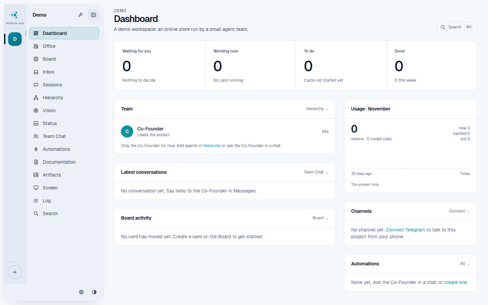
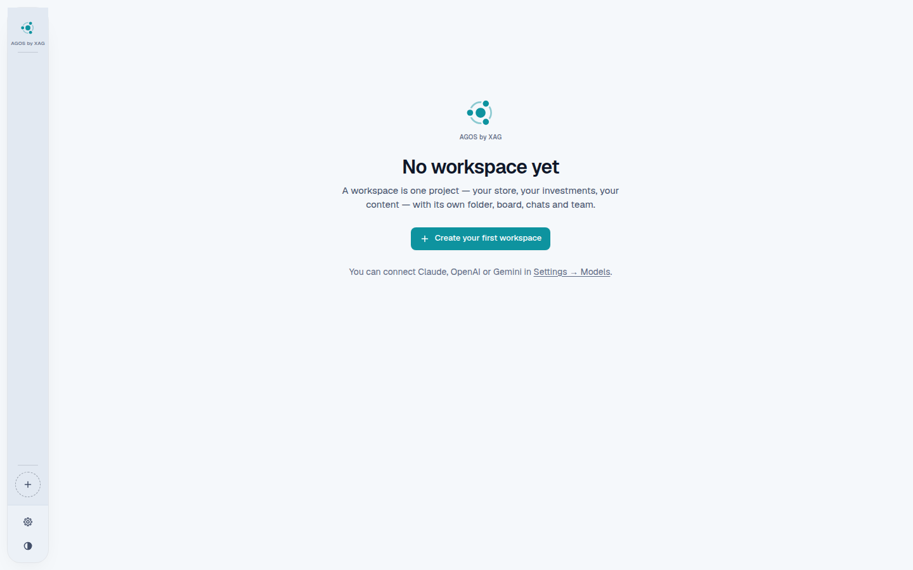
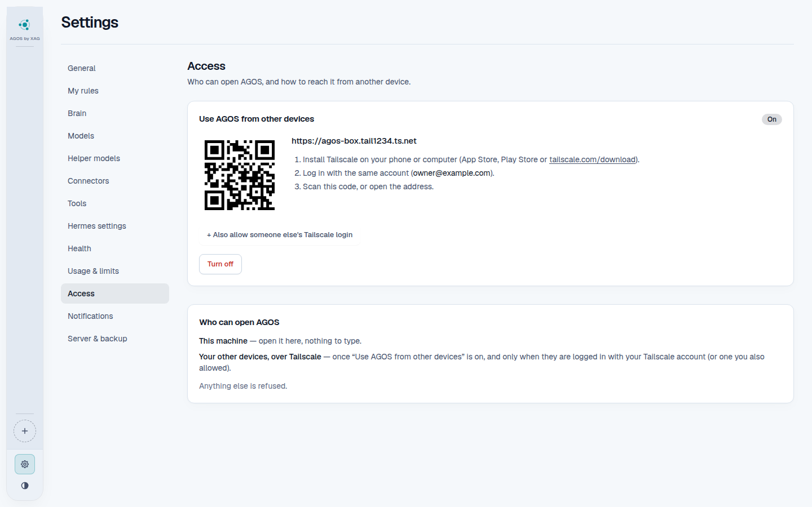

# AGOS by XAG

-blue>)


**Where one-person companies get built, grow and turn dreams into reality. You and agents.**

AGOS gives you workspaces, one per project. Each workspace has a Co-Founder
agent you talk to and a team of agents that do the work. You see and control
everything from one web app, on your computer or on your phone.

[Hermes Agent](https://github.com/NousResearch/hermes-agent) is the engine of
everything. Every agent, chat, memory, skill, schedule, board and sandbox runs
in Hermes. AGOS is the place where you see it and control it: it reads what
Hermes holds and writes through Hermes. It does not rebuild what Hermes already
does.



<table>
  <tr>
    <td></td>
    <td></td>
  </tr>
  <tr>
    <td align="center">The first start</td>
    <td align="center">Settings → Access: AGOS on your phone</td>
  </tr>
</table>

## What you get

- **Workspaces**: one per project, each with its own files, chats, keys and
  agents. Workspaces are closed to each other.
- **A Co-Founder and a team**: the Co-Founder plans with you, hires agents with
  clear roles and hands them work. It can do anything you can do in the app,
  and its changes come with an Undo.
- **Kanban**: every task is a card. Agents pick cards up, move them and ask you
  when they need a decision.
- **Chats**: talk to the Co-Founder or to any agent, on the web or on Telegram,
  with voice notes.
- **Automations**: schedules and webhooks that start work by themselves.
- **Skills and connectors**: reusable methods, MCP servers and app connections.
- **Any model**: OpenRouter, Anthropic, OpenAI, Gemini and more, with your own
  keys or subscriptions.
- **Safe by default**: agents run their tools in a sandbox, and risky actions
  wait for your approval.
- **Backups**: encrypted backups and restore, from the app or the command line.

## Requirements

|           | Minimum                                                                                            | Recommended                       |
| --------- | -------------------------------------------------------------------------------------------------- | --------------------------------- |
| Memory    | 4 GB (the installer stops below that, and warns under 8 GB)                                        | 16 GB for several busy workspaces |
| Free disk | 20 GB (the installer stops below that)                                                             | 50 GB+ (your files, backups)      |
| CPU       | 64-bit x86 or ARM, 2 cores                                                                         | 4 cores or more                   |
| System    | Ubuntu 24.04 LTS (tested) or 22.04 LTS; macOS 13+ / Windows 10 21H2+, 11 (preview, not yet tested) | Ubuntu 24.04 LTS                  |

AGOS runs on Linux. On a Mac it runs in a small Ubuntu VM (Lima). On Windows it
runs in WSL 2. The installer sets this up for you. How the numbers were
measured: [docs/INSTALL.md](docs/INSTALL.md#minimum-hardware).

**What is tested today:**

| System                                       | Status                                                                                      |
| -------------------------------------------- | ------------------------------------------------------------------------------------------- |
| Linux: Ubuntu 24.04 server, x86, 4 GB, 2 CPU | **tested** in a VM: fresh install, update and uninstall; runs a small load at 4 GB / 2 CPUs |
| Linux: Ubuntu 22.04, ARM                     | the installer accepts them; not tested yet                                                  |
| macOS (Lima VM)                              | **preview, not yet tested**: the installer exists, it has not been run on a real Mac        |
| Windows (WSL 2)                              | **preview, not yet tested**: the installer exists, it has not been run on a real Windows PC |

If you try a preview, please [open an issue](https://github.com/xag-go/agos-by-xag/issues) with what happened.

## Install

One command.

```bash
# Linux (Ubuntu 22.04 / 24.04) and macOS (preview, not yet tested)
curl -fsSL https://raw.githubusercontent.com/xag-go/agos-by-xag/main/install.sh | bash
```

```powershell
# Windows 10 / 11 (PowerShell; preview, not yet tested)
irm https://raw.githubusercontent.com/xag-go/agos-by-xag/main/install.ps1 | iex
```

The installer asks a few questions (each has a safe default) and takes 15–30
minutes. Every question, flag and option is in [docs/INSTALL.md](docs/INSTALL.md).
If it stops, [docs/troubleshooting.md](docs/troubleshooting.md) has the fix.

## Quick start

1. Open **http://localhost:3000**.
2. Connect a model provider in **Settings → Models**.
3. Create your first workspace with **New workspace**.
4. Open the Co-Founder's chat and say what the project is about. It proposes
   a team. Approve the hires in the **Inbox**.
5. Put work on the **Kanban**, or ask the Co-Founder to do it.
6. Optional: open AGOS on your phone with **Settings → Access → Activate**.
7. Set a backup password in **Settings → Server & backup**. Scheduled backups
   only run once a password is set.

The [user guide](docs/user-guide.md) explains every screen in a few lines.

## The `agos` command

| Command                                     | What it does                                                            |
| ------------------------------------------- | ----------------------------------------------------------------------- |
| `agos start` / `stop` / `restart`           | Start, stop or restart AGOS.                                            |
| `agos status`                               | What runs, workspaces, versions, where the data is.                     |
| `agos logs [core\|web\|hooks\|<workspace>]` | Follow a log (default: the core). A workspace id shows its Hermes logs. |
| `agos open`                                 | Open http://localhost:3000.                                             |
| `agos update [--check] [--yes]`             | Back up, then install the newest AGOS. Rolls back on failure.           |
| `agos backup`                               | Make a password-protected backup now.                                   |
| `agos restore <file.agosb>`                 | Put a backup back (your current data is kept aside).                    |
| `agos version`                              | AGOS's and Hermes's versions.                                           |
| `agos check`                                | The installer's checklist.                                              |
| `agos uninstall [--delete-data] [--yes]`    | Remove AGOS. Your data is kept unless you type `DELETE`.                |

Day-to-day operation (backups, updates, logs, monitoring) is in
[docs/operations.md](docs/operations.md). When something breaks, start with
[troubleshooting](docs/troubleshooting.md) (the common problems, each with its fix),
then the [runbooks](docs/runbooks/README.md).

## Use it from your phone

AGOS listens only on your own machine (127.0.0.1). Nothing is opened to the
internet. To reach it from your phone or another computer, open
**Settings → Access → Activate**. AGOS sets up [Tailscale](https://tailscale.com),
a private network that only your own devices join, and shows a QR code. Scan it
with your phone, then add AGOS to your home screen.

## Privacy

No tracking, no analytics, nothing is sent home. AGOS talks only to the model
providers and services you connect yourself. Your keys stay on your machine.

## Documentation

- **Using AGOS**: [user guide](docs/user-guide.md), [glossary](docs/glossary.md),
  [install](docs/INSTALL.md), [instant automations](docs/guides/instant-automations.md).
- **Running AGOS**: [operations](docs/operations.md),
  [troubleshooting](docs/troubleshooting.md), [runbooks](docs/runbooks/README.md), [Hermes upgrades](docs/hermes-upgrade.md).
- **Building AGOS**: [getting started](docs/guides/getting-started.md),
  [how to add a feature](docs/guides/how-to-add-a-feature.md),
  [testing](docs/guides/testing.md), [architecture](ARCHITECTURE.md),
  [decisions (ADRs)](docs/adr/README.md).
- **Everything**: [docs/README.md](docs/README.md).

## Built on Hermes Agent

Every agent in AGOS is a [Hermes Agent](https://github.com/NousResearch/hermes-agent)
agent, by Nous Research. AGOS adds the workspaces, the team, the screens and the
web app around it. Thank you to the Hermes team.

## Contributing

Ideas, bug reports and pull requests are welcome. See
[CONTRIBUTING.md](CONTRIBUTING.md) for how to run AGOS from source and how
changes are reviewed. Please follow the [Code of Conduct](CODE_OF_CONDUCT.md).
For security problems, follow [SECURITY.md](SECURITY.md).

## License

[MIT](LICENSE), © 2026 XAG.

The XAG name and logo belong to XAG and are not covered by the MIT license; do
not use them for other products.
