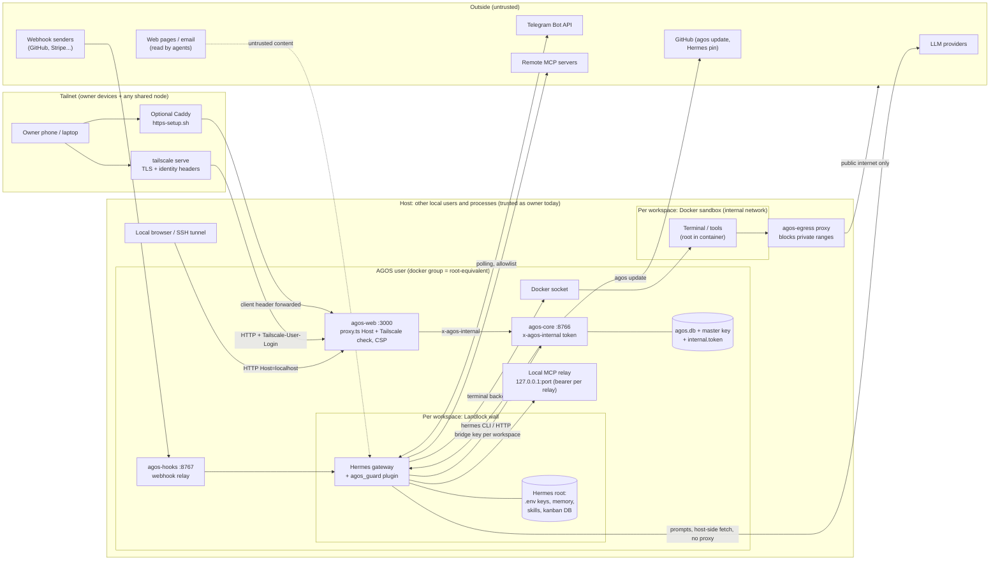

# AGOS threat model (STRIDE)

Assessed commit `33e135a1` (2026-11-02). Scope: one AGOS install on one Linux host, installed by
`deploy/install-server.sh`, used by one owner. Assets: the owner's provider keys and connector tokens, workspace files
and memory, the ability to act as the owner (Co-Founder actions, automations, outbound messages), host integrity.
`core/` = `services/core/src/agos_core/`; "sec §n" = the maintainers' internal security audit (not in the repository).

## Data flow and trust boundaries

| Boundary | Between                             | Control today                                                                                                                                                   |
| -------- | ----------------------------------- | --------------------------------------------------------------------------------------------------------------------------------------------------------------- |
| TB1      | Internet ↔ host                     | Nothing listens publicly; ufw default-deny, `tailscale0` allowed (`deploy/install-server.sh`, sec §10.5). Optional public tunnel only for `agos-hooks`.         |
| TB2      | Tailnet ↔ web                       | `tailscale serve` sets identity headers; `access.ts:76-89` allows only listed Host + login. Optional Caddy path forwards forged headers (sec §1.2).             |
| TB3      | Other local users/processes ↔ AGOS  | **None**: Host `localhost` = owner (`apps/web/src/server/access.ts:80`). Data dir 0700.                                                                         |
| TB4      | Web ↔ core                          | `x-agos-internal`, constant-time (`core/api/deps.py:16-22`); core binds 127.0.0.1.                                                                              |
| TB5      | Gateway ↔ core / other workspaces   | Per-workspace HMAC bridge key (`core/api/bridge_access.py` `_checked`); Landlock wall (`core/engine/wall.py`), except the Docker socket and `/proc` (sec §4.4). |
| TB6      | Gateway ↔ sandbox                   | Docker, caps dropped, no env/credential forwarding (`core/engine/rules.py:215-240`); terminal is root inside.                                                   |
| TB7      | Sandbox ↔ internet                  | `agos-egress` blocks private/loopback/CGNAT/metadata, resolves once (`core/engine/egress_proxy.py:32-63`). Public egress open.                                  |
| TB8      | Untrusted content ↔ agent decisions | Turn taint (plugin `agos_guard/taint.py` + core `actions/read_vs_act.py`): power actions wait for the owner, memory/skill writes held (eng/rva).                |
| TB9      | Hermes host-side ↔ providers / MCP  | HTTPS; MCP URL checked once at add time and allowed on DNS failure (`core/engine/library.py:138-142`).                                                          |

## STRIDE

| #   | Element / flow               | STRIDE | Threat                                                                                                                                    | Mitigation in place (evidence)                                                                                                                                                                                                                                                                                                                   | Status                                | Fix                                                                                                                                                                                                                            | Covered by                                                                      |
| --- | ---------------------------- | ------ | ----------------------------------------------------------------------------------------------------------------------------------------- | ------------------------------------------------------------------------------------------------------------------------------------------------------------------------------------------------------------------------------------------------------------------------------------------------------------------------------------------------ | ------------------------------------- | ------------------------------------------------------------------------------------------------------------------------------------------------------------------------------------------------------------------------------ | ------------------------------------------------------------------------------- |
| T1  | Web via tailnet              | S      | Tailnet device forges `Tailscale-User-Login` through Caddy                                                                                | Default `tailscale serve` strips/sets headers                                                                                                                                                                                                                                                                                                    | FAIL (Caddy path)                     | `header_up -Tailscale-User-*` or drop script                                                                                                                                                                                   | P4-F7                                                                           |
| T2  | Web via browser              | S/T    | DNS-rebinding page drives `127.0.0.1:3000`                                                                                                | Host allowlist on all routes but `/_next/image` (`proxy.ts:62`)                                                                                                                                                                                                                                                                                  | PARTIAL                               | Matcher covers `/_next/image` (in flight `e2b440f9`)                                                                                                                                                                           | W1-A                                                                            |
| T3  | Web                          | E      | Next 16.3.5 unauthenticated RCE (Image Optimizer, `use cache`, `next/og`)                                                                 | —                                                                                                                                                                                                                                                                                                                                                | FAIL                                  | next ≥16.4.1 (in flight `e2b440f9`)                                                                                                                                                                                            | W1-A                                                                            |
| T4  | Web                          | T      | CSRF on server actions                                                                                                                    | Next Origin==Host check; no CORS (sec §1.6)                                                                                                                                                                                                                                                                                                      | PASS                                  | —                                                                                                                                                                                                                              | —                                                                               |
| T5  | Web                          | I      | XSS via agent output                                                                                                                      | Nonce CSP, safe markdown, sandboxed iframes (sec §7)                                                                                                                                                                                                                                                                                             | PASS                                  | —                                                                                                                                                                                                                              | —                                                                               |
| T6  | Host local users             | S/E    | Any local user/process/SSH forward is the owner                                                                                           | Documented in code only                                                                                                                                                                                                                                                                                                                          | PARTIAL (accepted risk, undocumented) | SECURITY.md threat note; recommend single-user host                                                                                                                                                                            | W1-D (F14)                                                                      |
| T7  | Core API                     | S      | Local process calls core without token                                                                                                    | Token required on every router but `/health` (`core/api/app.py:483`)                                                                                                                                                                                                                                                                             | PASS                                  | —                                                                                                                                                                                                                              | —                                                                               |
| T8  | Core token                   | I      | Token read from `ps` / `/proc/<pid>/cmdline` during `agos` CLI calls                                                                      | —                                                                                                                                                                                                                                                                                                                                                | FAIL                                  | Pipe/stdin (in flight `2372a088`)                                                                                                                                                                                              | W1-A (F9)                                                                       |
| T9  | Bridge                       | D      | Unauthenticated 2 MB bodies parsed before key check                                                                                       | Loopback only                                                                                                                                                                                                                                                                                                                                    | PARTIAL                               | Auth as router dependency                                                                                                                                                                                                      | NEW                                                                             |
| T10 | Bridge / owner gate          | E      | Gate fails open on tool-check timeout; core does not re-check                                                                             | —                                                                                                                                                                                                                                                                                                                                                | FAIL                                  | Fail closed + core re-check (in flight `d4b2c75a`)                                                                                                                                                                             | W1-A (F4)                                                                       |
| T11 | Agent decisions              | T/E    | Prompt injection from web/email/webhook runs owner-level actions                                                                          | Read-vs-act: session-long taint (plugin + core, kept on disk), one-time Allow/Deny with a core-checked nonce, power table incl. Hermes `cronjob` and hub skill installs, marks carried to cards, jobs and woken results (`actions/owner_gate.py`, `actions/read_vs_act.py`, `agos_guard/taint.py`, `gate.py`; `tests/test_read_vs_act_fixes.py`) | PARTIAL (eng/rvafix)                  | Residual: a file a tainted session writes in `/workspace` and a later clean session reads, and a room member's words, are not marked; untrusted-read detection is a list (an unknown CLI that fetches without a URL is missed) | W2-RVA + NEW (file/room taint)                                                  |
| T12 | Agent powers                 | E      | Direct mode lets the agent create automations, MCP servers, keys, rewrite SOUL, self-approve memory                                       | `needs_owner` only for some kinds (`hermes_channel.py:2700-2706`)                                                                                                                                                                                                                                                                                | FAIL                                  | `needs_owner` for persistence/secrets; drop `approve_held_write`                                                                                                                                                               | P4-F6                                                                           |
| T13 | Webhooks                     | S/T    | Anyone with the route name injects a prompt into an automation                                                                            | Signing secret by default, shown once on every path (the dialog, or kept sealed until the owner shows it: `actions/hook_secrets.py`); webhook cards tainted                                                                                                                                                                                      | PARTIAL (eng/rvafix)                  | Webhooks made before signing stay unsigned until the owner clicks "Make a secret" (shown "unsigned" in the list and dialog; not migrated, so no delivery breaks silently)                                                      | P4-F8                                                                           |
| T14 | Gateway → other workspaces   | E/I    | Gateway code uses the Docker socket to mount `/` and read every root; reads `/proc/<core>/environ`                                        | Landlock covers paths only (`wall.py:17-18,49-53`)                                                                                                                                                                                                                                                                                               | FAIL                                  | No docker-group access for gateways (socket proxy limited to the workspace's sandbox spec), `hidepid`                                                                                                                          | NEW                                                                             |
| T15 | Local MCP relays             | S/I    | Other workspace (via rebinding MCP URL) or any local process reads a workspace's MCP tools                                                | Bearer per relay (`engine/mcp_runner.py`), whole header within 10 s, 128 connections at most; MCP DNS fail closed                                                                                                                                                                                                                                | PASS (eng/rva, eng/rvafix)            | Residual: the relay token is visible in `docker inspect` Config.Env to whoever has Docker access (gateways do: T14); the MCP server itself is reachable without auth from the same workspace's sandbox network                 | P4-F10 / W1-A                                                                   |
| T16 | Sandbox                      | E      | Container escape from root-in-container to host                                                                                           | caps dropped, no-new-privileges, pids limit (`Dockerfile:8-11`)                                                                                                                                                                                                                                                                                  | PARTIAL                               | Non-root terminal; rootless Docker                                                                                                                                                                                             | NEW                                                                             |
| T17 | Sandbox → internet           | I      | Exfiltration of workspace data after injection                                                                                            | Private ranges blocked; public egress open by design                                                                                                                                                                                                                                                                                             | PARTIAL                               | T11 + optional per-workspace egress allowlist                                                                                                                                                                                  | W2-RVA + NEW                                                                    |
| T18 | Sandbox / gateways           | D      | One runaway agent OOMs the host (no memory/CPU/pids limits on sandboxes or units)                                                         | Only egress proxy and MCP containers limited (`core/engine/hermes.py:4086-4089`)                                                                                                                                                                                                                                                                 | FAIL                                  | Unit + sandbox limits                                                                                                                                                                                                          | W2-STG                                                                          |
| T19 | Provider spend               | D      | Loop on a pay-per-token key burns money                                                                                                   | Account pause at % of subscription limit (`core/actions/account_pause.py`)                                                                                                                                                                                                                                                                       | PARTIAL                               | Per-workspace daily spend cap                                                                                                                                                                                                  | NEW                                                                             |
| T20 | Hermes root `.env`           | I      | Keys plaintext on disk (design: Hermes needs them)                                                                                        | Per-root files, wall RW only on own root, never in sandbox                                                                                                                                                                                                                                                                                       | PARTIAL (accepted)                    | Document exactly                                                                                                                                                                                                               | W1-D                                                                            |
| T21 | Supply chain                 | T      | Malicious skill/MCP/plugin, compromised Hermes update, unpinned base images, unpinned installers (`curl \| bash`, Caddy without checksum) | Hermes pinned by SHA; gitleaks; lockfiles                                                                                                                                                                                                                                                                                                        | PARTIAL                               | Vetting step; image digests; pinned+checksummed installers; signed releases ([slsa.md](slsa.md))                                                                                                                               | ADD + P4 (sec §10.2-10.3) + NEW                                                 |
| T22 | Installer URL                | S      | One-liners point at an old org/repo name that may not exist or be squatted                                                                | —                                                                                                                                                                                                                                                                                                                                                | FAIL                                  | One constant `xag-go/agos-by-xag` (in flight `fd00c5e5`)                                                                                                                                                                       | W1-A (F3)                                                                       |
| T23 | Repudiation: agent actions   | R      | Owner cannot tell who did what                                                                                                            | Audit row + Undo for every Co-Founder action                                                                                                                                                                                                                                                                                                     | PASS                                  | —                                                                                                                                                                                                                              | —                                                                               |
| T24 | Repudiation: access attempts | R      | Refused hosts, bad tokens, bad bridge keys leave no trace                                                                                 | — (`proxy.ts:42-46`, `deps.py:22`)                                                                                                                                                                                                                                                                                                               | FAIL                                  | Log refusals, alert on bursts                                                                                                                                                                                                  | NEW                                                                             |
| T25 | Core availability            | D      | Core hangs (not crashes) and is never restarted; crash loop unnoticed                                                                     | `Restart=always` (`install-server.sh:390-391`)                                                                                                                                                                                                                                                                                                   | PARTIAL                               | Watchdog + dead-man alert (in flight `eng/errors`)                                                                                                                                                                             | W1-C                                                                            |
| T26 | Backups                      | T/I    | Backup on the same disk; no backup at all without a password                                                                              | AES-encrypted `.agosb`, self-check (`core/actions/backups.py:300`)                                                                                                                                                                                                                                                                               | PARTIAL                               | Alert when no password / overdue; restore test                                                                                                                                                                                 | ADD (backup/disk alerts) + P5 (restore test); off-server copy declined by owner |
| T27 | Public history               | I      | Publishing the private history leaks personal author data                                                                                 | `scripts/publish-public.sh` squashes + gitleaks + private-words check                                                                                                                                                                                                                                                                            | PASS                                  | Keep it as the only publish path                                                                                                                                                                                               | —                                                                               |

**Score: 5 PASS / 27** (PARTIAL 10, FAIL 12). In-flight Wave 1 commits close T2, T3, T8, T10, T22 once merged
(10/27).
eng/rvafix (2026-11-03): after the independent review of eng/rva, T11 and T13 are rated PARTIAL (their rows name what
is left), T15 PASS with its residual.

## Accepted risks (owner decisions, keep visible)

- Local host = owner (T6) until a second-factor mode exists; recommend a dedicated machine.
- Provider keys plaintext in Hermes roots (T20).
- Public internet egress from sandboxes (T17) — mitigated by T11, not removed.
- Backups stay on the server (owner choice 2026-11-02).

## Review

Update this file whenever a trust boundary or a component changes (new listener, new outside service, new agent
power). Re-run monthly with the other compliance files ([README.md](README.md)).
